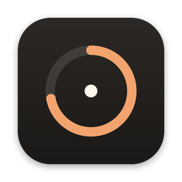

<p align="center"></p>

<h1 align="center">Drift</h1>
<p align="center"><em>Stay with it.</em></p>

Drift is a quiet focus timer for macOS. Press **⌥ Space** from any app, write what you're working on and for how long (`Reply to emails 25m`), press Return. A small timer appears in the top-left corner of your screen, and you get back to work. List a few time blocks (`Morning startup: inbox 10m, plan the day 10m, review calendar 5m`) and they run back to back as one session. Start it now, plan it for later today (`Client call at 2pm for 30m`), or make it a routine (`Deep work 9–10:30 weekdays`).

It needs no account and never touches the network.

**Website:** https://nweinberg97.github.io/Drift/

---

## Install

Paste this into **Terminal** and press Return:

```bash
curl -fsSL https://raw.githubusercontent.com/nweinberg97/Drift/main/scripts/install.sh | bash
```

The script builds Drift from source on your Mac, installs it to **Applications** and opens it. If macOS asks to install the free **Command Line Tools**, click Install, wait for it to finish, then run the command again.

Because Drift is built on your own machine, macOS opens it without the "unidentified developer" warning. You don't need a paid Apple account.

Requirements: macOS 13 Ventura or newer. If the build fails on an older Mac, update the Command Line Tools in **System Settings → General → Software Update**.

<details>
<summary>Other ways to install</summary>

- **From a clone:** `git clone https://github.com/nweinberg97/Drift && cd Drift && ./scripts/install.sh`
- **Prebuilt download:** every push builds a universal `Drift.zip` (with a SHA-256 checksum) under **Actions → latest run → Artifacts**. Builds downloaded this way are ad-hoc signed, not notarized, so the first time you open one you need to right-click Drift.app → **Open** → **Open**.
- **Just build it:** `./scripts/build-app.sh` creates `build/Drift.app`.

</details>

## Mac App Store build

`Drift.xcodeproj` is the App Store build (sandboxed, asset-catalog icon, privacy manifest, export compliance set). Everything for submission is in [`appstore/`](appstore/): a step-by-step guide, the listing copy, App Store Connect answers and screenshots. CI archives the project on every push to keep it working.

## Using Drift

| Do this | How |
|---|---|
| Start a timer | **⌥ Space**, write the task and the time (`Reply to emails 25m`) → Return. The time is highlighted as you type, and a preview shows the timer you're about to start. The box wraps onto more lines for long lists. **⌥ Space** always brings the launcher to the front; **Esc**, a click outside or **×** closes it. |
| Nothing running | The widget asks "What are you working on?" and offers **▶ Start 25m** (your default), one-tap **10m 15m 45m 1h**, and **⋯** for any length on the dial. |
| Task, no time | Type just `Draft proposal`. Drift suggests your default length in grey; **Tab** or Return takes it. |
| Time, no task | Type `25` → Return. The timer shows **+ Add task** so you can name it later. |
| Quick lengths | While the launcher is empty: **5m 10m 15m 25m 45m 1h** (**⌘1–⌘9** for your quick starts). If you've written a task, a length starts that task for that long. The menu bar has the same quick lengths. |
| Repeat a task | Recent tasks (and saved sessions) appear under the empty launcher with their usual length. One click starts one. |
| Sessions | Several time blocks as one timer: `Morning startup: inbox 10m, plan the day 10m, review calendar 5m`, or just `Code review 30m, then reply to emails 15m` (commas, "then", or one per line). Each block starts when the one before ends; the launcher shows each block's clock time and when it all ends. Named sessions are saved for one-click reuse. |
| Start now, later today or a routine | Under what you type, a switch: **Start now · Later today · Routine**, for single tasks and sessions. Drift picks it from your words (`Client call at 2pm for 30m` → Later today; `Weekly planning 30m fri at 4pm` or `Deep work 9–10:30 weekdays` → Routine; no time of day → Start now). Tapping a mode rewrites the text so it always says what will happen: Start now removes the time and days; Later today adds ` at 2:30pm today` (the next half hour at least 10 minutes away; the button reads **Tomorrow** when a typed time has already passed); Routine adds ` weekdays at 9am` (keeping a time you already have). Later today and Routine show an **At** row (the next three half hours, or 8:00 AM / 9:00 AM / 1:00 PM for a routine) and "or type “at 3:15pm”"; Routine adds an **On** row: Weekdays, Every day, M T W T F S S. The Return hint reads "Return to start", "Return to plan it" or "Return to add routine". |
| Between blocks | A hand-off card: "✓ Inbox done · Next: Plan the day, 10m · starts in 10s", with **Start now** / **Pause**. Settings → **Next time block starts**: right away, 5s, 10s, 30s or when I press Start. |
| Extra time | Time blocks don't stretch unless Settings → **Extra time in sessions** is on. **Grace period** (Off / 5 / 10 / 15 min) caps extra time per timer or time block. |
| Speak | **⌥ V**, or **⌥ Space** twice, then say "twenty five minutes to reply to emails", or a whole session: "Morning startup, ten minutes of inbox, then ten minutes to plan the day, starting at 8". Drift stops listening when you pause. |
| Show / hide the widget | **⌥ T**. While hidden, the time shows in the menu bar and timers keep running. |
| Pause / resume | Click ⏸ on the widget, or type `pause` / `resume` in the launcher. |
| Name or rename | Click a timer's name (or **+ Add task**) and type, right in the widget. Return saves. |
| Change the time | Click the time to open the dial. Drag around it (a minute per notch, a full turn is an hour), scroll, or use the arrow keys (⇧ for 5 min). Or tap −5/−1/+1/+5 or a preset. Cancel puts the old time back. |
| Multiple timers | Click the ⌄ button on the widget to expand it, then **+ New timer**. With several running, the button shows `+2`; click it to see them all. Each one's name and time are clickable too. |
| Pomodoro | Type `pomodoro` or `50/10`, or press **⌘P** in the launcher. Focus and break alternate until you cancel. |
| Plan it | When it happens is highlighted in blue. A card at the top of the widget confirms it: **PLANNED** (once, later today) or **ROUTINE ADDED** (repeating), with what, when, each block's time and "Today at 2:30 PM, Drift checks in and starts it for you", and **Got it** / **Edit** / **Undo** (after editing: **UPDATED**, with **Got it** / **Edit** / **Delete**). It joins **Today** in the expanded widget and the menu bar. The widget's **+ Plan** (beside Today) and **Plan** (footer, while nothing is planned), and menu bar → More Ways to Start → **Plan Later Today…** / **New Routine…** open the editor. |
| When it's time | A soft chime, a banner and a card in the widget: **Start**, **In 5 min** or **Skip today**. Ignore it and it starts by itself after a minute. Its timer ends when it was planned to end, so starting late keeps the time box. |
| Change a planned item | Click it in **Today** (or the menu bar). The editor (**PLAN LATER TODAY** / **NEW ROUTINE** / **EDIT**) has a 4-hour timeline that snaps to 5 minutes (hold **⌥** while dragging for single minutes); click the start or end time to type an exact one (`2:50`, `250`, `2:50pm`); nudge **−5 −1 +1 +5**; pick a length; **Repeat**: Today (or Tomorrow) / Weekdays / Every day plus day toggles. Save is **Plan it**, **Add routine** or **Save**. For a routine, choose **Just today** or every day it repeats. |
| Delete or skip | Hover a row in the widget's Today list → **×**. Right-click a row → **Edit…** / **Skip Today** / **Delete** (**Delete Routine** for repeating ones). In the menu bar each Today row has the same submenu; the editor has **Delete** / **Delete routine**. An Undo bar ("Deleted “Deep work” · Undo") stays at the top of the widget for about 6 seconds. |
| Time's up | The widget shakes (Settings → **Shake the widget when time's up**, on by default; it stops the moment you touch the widget) and shows **TIME'S UP · Reply to emails · 25 minutes complete** with a big **Done**, **+5m** and **Restart**. Sessions end with **SESSION COMPLETE** and **Run again**. The notification reads "Time's up: Reply to emails". |
| Less clutter | The launcher, widget and menu show only what fits the moment. The menu bar menu is short: timers, Today, New Timer… with quick lengths (5m 10m 15m 25m 45m 1h), **More Ways to Start** (saved sessions, Pomodoro, voice, Plan Later Today…, New Routine…), focus sound. Settings → **Features** has switches for Plan my day, Focus sounds, Pomodoro and Voice; turning one off removes it everywhere, nothing deleted. |
| Move it | Drag the widget anywhere. It remembers the position and display. |

### What you can type (or say)

```
Reply to emails 25m   → "Reply to emails", 25 minutes
Draft proposal        → "Draft proposal", your default length (Tab to accept)
code review 30m       → "Code review" (a task can start with any verb)
25                    25 minutes, no name yet (a bare number means minutes)
Morning startup: inbox 10m, plan the day 10m, review calendar 5m
                      → a session: 3 time blocks, back to back
Code review 30m, then reply to emails 15m
                      → a session without a name
… at 2:30pm today      → the same, later today
Client call at 2pm for 30m   → later today (or tomorrow, if 2pm has passed)
Deep work 9-10:30 weekdays   → a routine: every weekday, 9:00–10:30
Weekly planning 30m fri at 4pm   → a routine: every Friday, 4:00–4:30
prep for standup tomorrow at 9:15am   → once, with your default length
1:30              1 hour 30 minutes
90s · 2h 15m · 36h · 3d · 1.5h
an hour and a half · half an hour · twenty five minutes
pomodoro · 50/10
pause · resume · pause code review
add 5 minutes · take 5 minutes off focus
cancel the code review timer · show my timers · hide
```

The launcher previews what Return will do as you type, so there are no surprises.

### Automation (Shortcuts, Siri, Raycast, Terminal)

Drift handles `drift://` links:

```bash
open "drift://start?duration=25m&name=Reply%20to%20emails"
open "drift://run?q=45%20minutes%20draft%20proposal"
open "drift://new"     # launcher
open "drift://voice"   # start listening
open "drift://show"    # drift://hide, drift://toggle
```

To use Siri, create a Shortcut with **Open URLs** → `drift://start?duration=25m`, name it something like "Focus", then say *"Hey Siri, focus."*

Any website can try to open a custom link, so links can only start, show, pause, resume or extend timers. They can never cancel or shorten one.

---

## 1. Product summary

Drift is a menu-bar utility with one floating widget. It does one job: it gets a timer running in under two seconds from anywhere, then stays out of the way.

- **Floating widget** (top-left by default). With nothing running it asks "What are you working on?" and offers ▶ Start 25m, four one-tap lengths and ⋯ for any length. While a timer runs it's a single line showing the state dot, the task, the time and pause. Click the task to rename it in place, click the time for the dial, click the ⌄ to expand. You can drag it, it remembers its position, and it shows above full-screen apps on every Space.
- **Launcher** (⌥ Space). A task-first, Spotlight-style field: "What are you working on?" It wraps onto more lines for long lists, highlights the time it found, previews the timer (or each time block with its clock time), suggests your default length when you leave it out, and, while empty, lists quick lengths and recent tasks. It has a mic button, a × close button and a **Start now · Later today · Routine** switch that's picked from your words and rewrites them when tapped.
- **Sessions**. One timer made of time blocks that run back to back (`Morning startup: inbox 10m, plan the day 10m, review calendar 5m`). A hand-off card between blocks; named sessions are saved. Blocks don't stretch unless Settings allows it; an optional grace period caps extra time.
- **Later today and routines**. Plan in words (`Client call at 2pm for 30m`, `Deep work 9-10:30 weekdays`). A Planned or Routine added card confirms each one. When one comes up Drift asks, then starts it on its own; it ends on time. Edit on a 4-hour timeline (5-minute snaps, ⌥ for single minutes) or type exact times, for every day or just today. Delete from a hover ×, right-click, the menu bar or the editor, with a few seconds to Undo. Stored in `~/Library/Application Support/Drift/schedule.json`.
- **Voice** (⌥ V). Push-to-talk, recognised on-device, using the same command grammar as typing.
- **Multiple timers**. One featured timer plus an expandable tray, never a wall of widgets.
- **Menu bar**. A tiny ring that empties as time passes. A short menu: every timer with a submenu (pause, ±5m, change time, rename, duplicate, cancel), Today, New Timer… with quick lengths (5m 10m 15m 25m 45m 1h), More Ways to Start (saved sessions, Pomodoro, voice, Plan Later Today…, New Routine…), focus sound, settings. Each Today row has Edit… / Skip Today / Delete.
- **Sound**. A soft synthesised start tick and a three-note completion bell that keeps chiming until you dismiss it (or once, if you prefer). **Focus sound** is off by default and offers nine sounds in three sets, all generated live and offline: Nature (Rain, Ocean, Fireplace), Chill (Lo-fi, Ambient, Soft Pad) and Focus (Hush, Binaural Focus, Binaural Calm).
- **Notifications** are scheduled with macOS at start, so they arrive on time even if Drift is asleep or quit.
- **Time's up**. The widget shakes until you touch it (optional) and shows a Time's up card with a big Done, +5m and Restart.
- **Settings** are one short page: Features switches (Plan my day, Focus sounds, Pomodoro, Voice), default length, presets, shake, finished-timer behavior, sessions and extra time, theme, widget size and opacity, sounds, shortcuts and launch at login.

## 2. Architecture

**A native Swift app**, not a browser extension. Every capability that mattered most needs the OS: a floating window above all apps and full-screen Spaces, global hotkeys, the menu bar, notifications, on-device speech and reliable background timing. An extension only lives inside a browser.

```
Sources/
  DriftCore/            Pure logic, no UI, fully unit-tested
    DriftTimer.swift      state machine: idle → running(endDate) ⇄ paused(remaining) → finished
    DurationParser.swift  "1h 30m", "45m code review", "an hour and a half" → seconds + name
    CommandParser.swift   typed/spoken commands → DriftCommand
    TimeFormatter.swift   7:32 · 1:42:18 · 27h 14m · 3d 6h
  Drift/                The app (SwiftUI views hosted in AppKit windows)
    App/                  entry point + wiring
    Model/                TimerStore (state, ticking, persistence), AppSettings
    Widget/  Composer/  MenuBar/  Settings/
    Shortcuts/            Carbon RegisterEventHotKey (global, no Accessibility permission)
    Voice/                SFSpeechRecognizer, on-device only
    Audio/                synthesised chimes + procedural focus sound (AVAudioEngine)
    Services/             notifications, command runner
```

Key decisions:

- **Timestamps, not ticks.** A running timer stores its `endDate`, and remaining time is `endDate − now`. Sleep, App Nap, a frozen UI or a force-quit can't make it drift. Timers that end while the Mac is asleep are marked finished on wake. Drift chimes only if the end was under a minute ago, so you never get chimed about something long past.
- **No polling loop.** The store wakes exactly when the visible second changes or a timer ends. With no running timers, Drift does nothing.
- **Non-activating panels.** Clicking the widget never steals focus from the app you're working in. The panel takes the keyboard only while you're typing into it.
- **SwiftUI inside AppKit.** SwiftUI handles views and animation. AppKit handles what SwiftUI can't do well: borderless panels, window levels, Spaces behavior, status items and hotkeys.
- **Local persistence.** Timers are saved as JSON in the app's container, written atomically on every change. Settings go in UserDefaults. There's no backend.
- **Security.** Drift is sandboxed with the hardened runtime. Its only entitlement is the microphone. It has no network entitlement at all, so it can't phone home even by accident. Speech recognition is required to run on-device.

## 3. Key UX decisions

- **One key, then type.** The fastest way to start a timer from anywhere is a launcher, not a button. ⌥ Space + `25` + Return takes about a second. Return on an empty field starts your default, so it's two keystrokes in total.
- **Task first.** The launcher asks what you're working on, because a named timer is easier to come back to. The time can go anywhere in the sentence, and if you leave it out you get your default.
- **Edit where it is.** Names and times are edited in place: click the name to type, click the time for a dial. No separate edit screens.
- **A bare number means minutes**, and `1:30` means hours:minutes, because that's what people mean. Leftover words become the name (`45m code review` → *Code review*), so you never have to fill in a name field.
- **The text always says what will happen.** Start now, Later today and Routine are picked from your words, and tapping one rewrites the words instead of setting a hidden option.
- **A live preview under the field** shows exactly what Return will do ("Start 45:00 · Code review", "Pause · Reply to emails"). That removes the guesswork from parsing.
- **Push-to-talk voice, not a wake word.** An always-on "Hey Drift" would keep your microphone open all day, so voice listens only after ⌥ V and stops on silence. For hands-free use, Siri works through a Shortcut and a `drift://` link.
- **One featured timer.** Several timers collapse into a `+N` badge, and expanding shows a compact tray sorted by what ends soonest. Click any timer to feature it.
- **The accent color means "something is happening."** A warm ember accent marks only running timers, the last minute and completion. Everything else is warm neutral, so the widget is calm enough to leave on screen all day.
- **Tabular digits in a stable box.** The width changes only when the format does (10:00 → 9:59), never every second.
- **Hiding is safe.** The time moves into the menu bar, timers keep running, and ⌥ T brings the widget back.
- **Completion is hard to miss, then gets out of the way.** A soft bell, one notification ("Time's up: Reply to emails"), a shake that stops when you touch the widget, and a card with one big Done. +5m snoozes. Drift never auto-starts another timer unless you chose Pomodoro, a session (its next block), or something you planned for later today or as a routine.
- **No frozen 25:00.** With nothing running, the widget asks what you're working on and starts with one tap, instead of showing a timer that isn't running.
- **Show only what fits the moment.** Quick lengths and recents show only while the launcher is empty; features you switch off in Settings disappear from every menu.

## 4. How to run it

```bash
# Install to /Applications and launch
./scripts/install.sh

# Or just build
./scripts/build-app.sh           # → build/Drift.app
open build/Drift.app

# Universal (Apple silicon + Intel); needs full Xcode
./scripts/build-app.sh --universal

# Unit tests (need Xcode, since the Command Line Tools ship without XCTest)
swift test
```

To open in Xcode: `open Package.swift`. Note that notifications and the app sandbox only apply when you run the bundled app, not `swift run`.

## 5. How to test it

**Automated** (`swift test`, run on every push by CI): duration parsing in every format above, command parsing (start, pause, resume, cancel, adjust, Pomodoro, show and hide, graceful failure), the timer state machine (pause/resume, ±5m, snoozing a finished timer, Pomodoro phases), timestamp accuracy at 5s, 25m, 90m, 24h and 36h, formatting, and save/load round-trips.

**By hand:**

- [ ] ⌥ Space in Chrome, VS Code and a full-screen app → type `25` → Return → the timer appears top-left
- [ ] Try `90s`, `1:30`, `2h 15m`, `36h`, `Draft proposal 45m`, `Draft proposal` (Tab), `pomodoro`. Each preview should be correct and the time highlighted.
- [ ] Type `Morning startup: inbox 1m, plan the day 1m, review calendar 1m`: each block shows its clock time; tap **Later today** and the text gains "at … today"; tap **Routine**, then a day, and it reads "… weekdays at …" / "mon tue … at …"; **Start now** takes it out again. Start it now: the hand-off card appears between blocks; the session ends with Session complete.
- [ ] Type `Prep for standup at <two minutes from now> for 15m`. The switch shows Later today and the **PLANNED** card confirms it. When it comes up: chime, banner, the card; leave it and it starts itself after a minute and ends on time.
- [ ] With nothing running: the widget shows "What are you working on?", ▶ Start 25m, 10m 15m 45m 1h and ⋯.
- [ ] Settings → Features: turn off Pomodoro and Voice; they disappear from the launcher, widget and menu. Turn them back on.
- [ ] Edit a routine: drag it (5-minute steps, ⌥ for 1), click the start time and type `9:35`, choose **Just today**; tomorrow's time is unchanged.
- [ ] Delete a Today row from the hover ×, right-click and the menu bar; the Undo bar brings it back.
- [ ] Click **+ Add task** on an unnamed timer, type, Return. Click the time, drag the dial, scroll, press arrows, then Cancel (time restores) and Done.
- [ ] Click the widget's pause while typing in another app. Keep typing: your keystrokes still land in that app.
- [ ] Click the time → −5m / +5m / Edit (`10m`) / Cancel
- [ ] Start 3 timers → `+2` badge → expand → click one to feature it
- [ ] Drag the widget, quit Drift, reopen → same place, timers still running
- [ ] ⌥ T hides it → time shows in the menu bar → ⌥ T brings it back
- [ ] Start a `5s` timer → bell + notification ("Time's up: …") + shake → touching the widget stops the shake → +5m snoozes, Done clears it
- [ ] Start a 2m timer, sleep the Mac for 5 minutes, wake → timer shows Done, with no late chime
- [ ] Unplug the external display the widget is on → it moves back to the main display
- [ ] Menu bar → Focus Sound on → start a timer → sound fades in. Pause → it fades out. Try each soundscape and the volume slider.
- [ ] ⌥ V → "start a 10 minute timer called code review". Then try "pause", "add 5 minutes", "cancel the code review timer" and "show my timers". Saying nonsense should give a friendly hint.
- [ ] Settings → re-record a shortcut → it works from other apps
- [ ] Turn on Reduce Motion and Increase Contrast. Use VoiceOver on the widget and menu.
- [ ] `open "drift://start?duration=3m&name=Prep%20for%20standup"`

## 6. Known limitations

- **Not notarized.** Notarization needs a paid Apple Developer account. Building with the install script avoids the Gatekeeper prompt entirely. Prebuilt zips need right-click → Open the first time.
- **No custom wake word.** "Hey Drift" would mean an always-open microphone, which isn't worth it. Use ⌥ V, or "Hey Siri" with a Shortcut (see Automation).
- **Voice needs on-device speech.** Drift has no network access, so if your Mac hasn't downloaded the on-device speech model, voice will ask you to turn on **Dictation** (System Settings → Keyboard) once. Voice is English (US) for now.
- **macOS asks for permissions again after each rebuild** (microphone, notifications). Ad-hoc signatures change with every build. Signed releases would fix this.
- **Global shortcut conflicts.** If another app (often Alfred or Raycast with ⌥ Space) already owns a combination, macOS gives it to whichever app registered first. Reassign it in Settings.
- **Keyboard control of the widget itself** (space to pause, +/−, Return, Esc) works while the widget has focus, for example after renaming or with the dial open. From other apps, the launcher's commands (`pause`, `add 5 minutes`…) are the keyboard path. This is deliberate, so the widget never steals your typing.
- **No Siri / App Intents integration yet.** SwiftPM builds can't produce App Intents metadata. The `drift://` + Shortcuts route covers the same ground.
